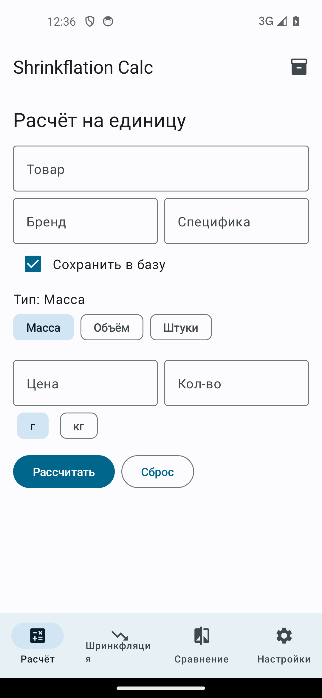
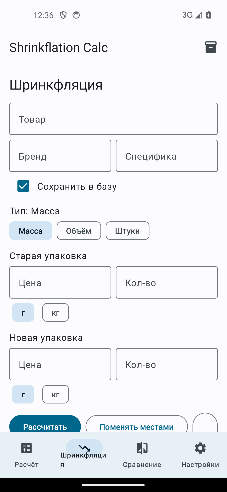
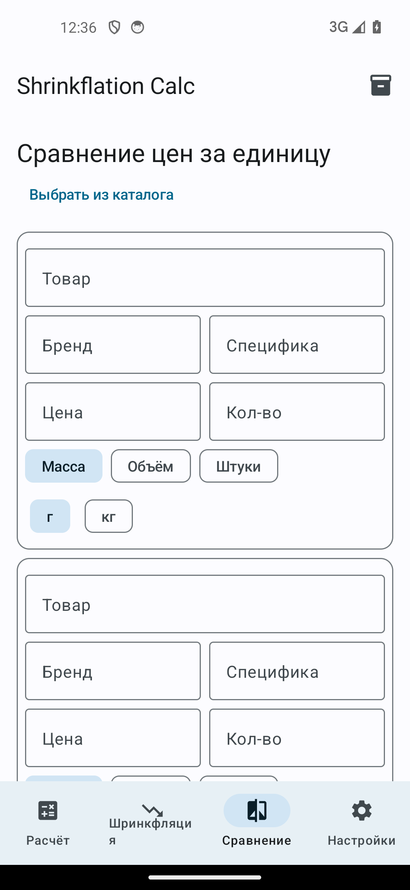
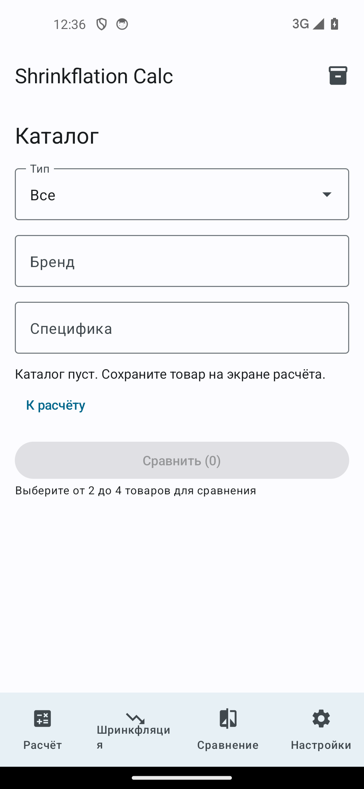
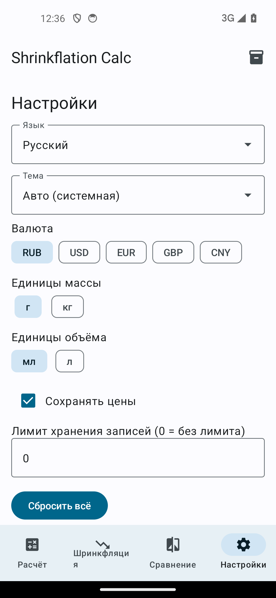

# Shrinkflation Calc

Android-приложение для выяснения, не «сжался» ли товар: сколько стоит 1 кг / 1 л / 1 шт, сравнение двух–четырёх товаров и каталог сохранённых цен.

## Возможности

- **Расчёт** — цена за целую единицу (`1 кг`, `1 л`, `1 шт`) с выбором единиц измерения; подсказки по уже сохранённым товарам, брендам и спецификам; сохранение в базу.
- **Шринкфляция** — сравнение старой и новой упаковки: изменение цены за единицу и размера.
- **Сравнение** — 2–4 товара, понятный результат: цена за целую единицу, валюта, самый выгодный товар (★), разница в `%` и в абсолютном значении.
- **Каталог** — список сохранённых вариантов товара с фильтрами по типу, бренду и спецификате; мультивыбор до 4 позиций и переход в сравнение с заполненными полями; редактирование и удаление с подтверждением.
- **Настройки** — язык (RU/EN), тема (системная/светлая/тёмная), валюта, единицы массы и объёма, лимит хранения записей.

## Скриншоты

<p>



</p>

- **Расчёт на единицу** — карточка товара, цена, количество и единицы измерения; результат — цена за 1 кг / 1 л / 1 шт.
- **Шринкфляция** — старая и новая упаковка рядом: сразу видно, изменилась ли цена за единицу.
- **Сравнение** — до 4 товаров; результат показывает цену за целую единицу, самого выгодного победителя и разницу с остальными.

<p>


</p>

- **Каталог** — фильтры по типу, бренду и спецификате, мультивыбор и переход в сравнение (на скриншоте пустое состояние).
- **Настройки** — язык, тема, валюта, единицы измерения и лимит хранения записей.

## Стек

- Kotlin, Jetpack Compose + Material 3
- Hilt, Navigation Compose
- Room (реляционная схема `products` → `product_variants` → `price_entries`)
- DataStore Preferences
- Coroutines + Flow
- JUnit 4, Compose UI Test

Цены хранятся строками и считаются через `BigDecimal` — без ошибок округления `Float`/`Double`.

## Требования

- JDK 17
- Android SDK 34 (platform + build-tools), Android 8.0+ (minSdk 26) на устройстве или эмуляторе
- Переменные окружения `JAVA_HOME` и `ANDROID_HOME`/`ANDROID_SDK_ROOT`

## Сборка и запуск

```bash
./gradlew :app:assembleDebug
adb install -r app/build/outputs/apk/debug/app-debug.apk
```

Тесты:

```bash
./gradlew :app:testDebugUnitTest          # локальные unit-тесты калькуляторов
./gradlew :app:connectedDebugAndroidTest  # UI-тесты на подключённом эмуляторе/устройстве
```

## Структура

```
app/src/main/java/com/team/itexperts/shrinkflation/
├── calc/          # расчёты (цена за единицу, сравнение)
├── data/          # Room: entity, DAO, репозитории, конвертеры
├── model/         # доменные модели
├── storage/       # DataStore настроек
├── ui/            # экраны Compose и ViewModel
└── util/          # LocaleHelper, подписи полей
app/src/main/res/values/       # русские строки (по умолчанию)
app/src/main/res/values-en/    # английские строки
```

## Лицензия

MIT — см. [LICENSE.md](LICENSE.md).
